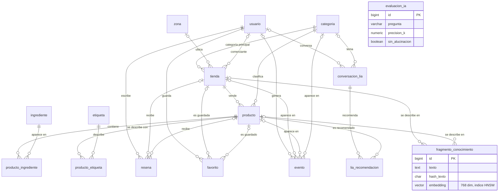

# StyleMe

Plataforma para descubrir tiendas físicas de moda y belleza de Bucaramanga (Santander, Colombia): dónde quedan,
cómo contactarlas, cómo armar una salida de compras, un probador virtual y **Lía**, una asesora con inteligencia
artificial que recomienda productos reales del catálogo usando **embeddings, búsqueda semántica y RAG**.

> Proyecto académico · Estado: **Fase 0 completa** (organización). En construcción: base de datos vectorial,
> backend y módulos de IA. Plan completo en [docs/planeacion/14-plan-ramas-y-fases.md](docs/planeacion/14-plan-ramas-y-fases.md).

---

## Arquitectura

```
   iu/ (página web)                           n8n (automatizaciones)
        │  REST                                      │  webhooks
        ▼                                            ▼
 ┌──────────────────────── backend/ (Spring Boot) ────────────────────────┐
 │  infraestructura  →  aplicacion  →  dominio      (arquitectura hexagonal) │
 └───────────┬──────────────────────┬───────────────────────┬─────────────┘
             ▼                      ▼                       ▼
   PostgreSQL + pgvector     Gemini (embeddings      n8n (avisos y
   (datos + índice HNSW)      y respuestas de Lía)     reportes con IA)
```

- **Arquitectura hexagonal** (puertos y adaptadores): [docs/planeacion/16-arquitectura-hexagonal.md](docs/planeacion/16-arquitectura-hexagonal.md)
- **Modelo de datos** (16 tablas, con búsqueda vectorial): ver la sección siguiente

---

## Modelo de datos (diagrama entidad-relación)

**16 tablas** en PostgreSQL + pgvector, organizadas en 4 grupos y **normalizadas hasta la cuarta forma normal (4FN)**.



| Grupo | Tablas | Para qué |
|---|---|---|
| **Catálogo** | `categoria`, `zona`, `tienda`, `producto`, `ingrediente`, `producto_ingrediente`, `etiqueta`, `producto_etiqueta` | Tiendas y productos reales, con ingredientes y características |
| **Comunidad** | `usuario`, `resena`, `favorito` | Usuarios con roles, reseñas de 1 a 5 corazones y favoritos (de tiendas y productos) |
| **Análisis** | `evento`, `conversacion_lia`, `lia_recomendacion` | Lo que pasa en la página y con Lía, para el informe de indicadores |
| **IA (RAG)** | `fragmento_conocimiento`, `evaluacion_ia` | Textos con su **embedding** (`vector(768)`, índice **HNSW**) y resultados de las pruebas de IA |

**Normalización:**
- **1FN:** sin listas en un campo (los ingredientes van en `producto_ingrediente`).
- **2FN:** en las tablas con llave compuesta, cada dato depende de la llave completa (`orden` depende del producto **y** del ingrediente).
- **3FN:** sin dependencias transitivas (`tienda` guarda `zona_id`, no el nombre de la zona).
- **4FN:** ingredientes y etiquetas son hechos independientes, por eso van en tablas separadas.

Diagrama completo con todos los campos y reglas: [docs/diagramas/entidad-relacion.dbml](docs/diagramas/entidad-relacion.dbml) ·
Explicación detallada: [docs/diagramas/entidad-relacion.md](docs/diagramas/entidad-relacion.md) ·
Diseño de cada campo: [docs/planeacion/15-modelo-de-datos.md](docs/planeacion/15-modelo-de-datos.md)

---

## Estructura del proyecto

```
StyleMe/
├── iu/                     Interfaz de usuario: la página web
│   ├── *.html              Inicio, tiendas, productos, mapa, salida, probador, recomendador, favoritos, acerca y admin
│   ├── Dockerfile          Imagen con nginx (sirve la página y reenvía /api/ al backend)
│   └── assets/
│       ├── css/            Estilos, animaciones e intro
│       ├── js/             api.js (conexión con el backend), comun.js, un archivo por página; lia/ (personaje y plan B)
│       ├── lia/            Lía: retrato 2D con sus expresiones
│       └── img/            Fotos de tiendas, categorías y decoración
│
├── backend/                API Spring Boot con arquitectura hexagonal
│   └── src/main/java/co/styleme/
│       ├── dominio/        Modelo y reglas del negocio (Java puro)
│       ├── aplicacion/     Puertos y casos de uso (Java puro)
│       └── infraestructura/ Adaptadores: REST, PostgreSQL, pgvector, Gemini, n8n
│
├── basedatos/              Scripts SQL: esquema, índices (HNSW), datos iniciales y vistas
├── n8n/                    Workflows de n8n (moderación con IA, reindexación, reporte semanal)
│
├── docs/
│   ├── planeacion/         Visión, decisiones, plan de ramas, modelo de datos y arquitectura
│   ├── diagramas/          Entidad-relación y arquitectura
│   ├── pruebas/            Documento de pruebas e informe de calidad de la IA
│   ├── evidencias/         Swagger y Postman
│   └── informe-datos/      Informe de análisis de datos
│
├── .env.example            Variables de entorno (copiar como .env)
├── IAS_usadas.md           Registro del uso de inteligencia artificial (AI_USAGE)
└── README.md
```

Cada carpeta tiene su propio `README.md` con el detalle.

---

## Tecnologías

| Parte | Herramienta |
|---|---|
| Interfaz de usuario | HTML, CSS y JavaScript |
| Backend | Java 21 · Spring Boot · Maven · arquitectura hexagonal |
| Base de datos | PostgreSQL + **pgvector** (índice vectorial HNSW) |
| IA de Lía | [Gemini API](https://ai.google.dev/): embeddings (`gemini-embedding-001`) y modelo de lenguaje, con RAG |
| Automatización | [n8n](https://n8n.io/) |
| Contenedores | Docker y Docker Compose |
| Pruebas | JUnit, Mockito, ArchUnit, Testcontainers, Postman |
| Documentación de la API | Swagger (springdoc-openapi) |
| Mapas | [Leaflet](https://leafletjs.com/) + [OpenStreetMap](https://www.openstreetmap.org/) |
| Probador virtual | [MediaPipe Pose Landmarker](https://ai.google.dev/edge/mediapipe/solutions/vision/pose_landmarker) (corre en el navegador) |

---

## Requisitos para trabajar en el proyecto

| Herramienta | Versión | Para qué |
|---|---|---|
| Java (Temurin) | 21 | Backend |
| Maven | 3.9 o superior | Compilar el backend (el proyecto también trae `mvnw`) |
| Docker Desktop | reciente | Base de datos, n8n y el sistema completo |
| VS Code | reciente | Extensiones: Extension Pack for Java, Spring Boot Extension Pack, Docker, PostgreSQL, Live Server |

---

## ⚠️ IMPORTANTE: versión de Java (SDKMAN)

El backend usa **Java 21**. Si ya tienes Java 21 instalado y la variable `JAVA_HOME` apunta a él, no necesitas nada más.
Para instalar Java o **cambiar de versión** cuando haga falta se usa **[SDKMAN](https://sdkman.io/)**.

### 1. Instalar SDKMAN en Windows (una sola vez)
SDKMAN no funciona en PowerShell: se usa desde **Git Bash** (viene con Git).

1. SDKMAN necesita el programa `zip`, que Git Bash no trae:
   - Descarga `zip` y `bzip2` de [GnuWin32](https://gnuwin32.sourceforge.net/packages/zip.htm) (los "Binaries").
   - Copia `zip.exe` y `bzip2.dll` en `C:\Program Files\Git\usr\bin`.
2. Abre **Git Bash** y ejecuta:
   ```bash
   curl -s "https://get.sdkman.io" | bash
   ```
3. Cierra y vuelve a abrir Git Bash. Comprueba con `sdk version`.

### 2. Instalar y cambiar la versión de Java
```bash
sdk list java                  # lista las versiones; busca una "21.x.x-tem" (Temurin)
sdk install java 21.x.x-tem    # cambia 21.x.x por la versión exacta que aparezca
sdk default java 21.x.x-tem    # versión por defecto, para siempre
sdk use java 17.x.x-tem        # cambia la versión SOLO en esa terminal
sdk current java               # qué versión está activa
java -version                  # confirmar
```

### 3. Que el proyecto elija su versión solo
En la carpeta `backend/` habrá un archivo `.sdkmanrc` con la versión del proyecto. Al entrar a la carpeta:
```bash
cd backend
sdk env          # activa la versión que dice .sdkmanrc
```
(Para crearlo: `sdk env init` dentro de `backend/`.)

### 4. Que VS Code y PowerShell usen esa versión
SDKMAN solo cambia la versión dentro de Git Bash. Para el resto de Windows, crea la variable de entorno **`JAVA_HOME`**:
- *Inicio → "Editar las variables de entorno del sistema" → Variables de entorno → Nueva (usuario)*
- Nombre: `JAVA_HOME` · Valor: `C:\Users\TU_USUARIO\.sdkman\candidates\java\21.x.x-tem`
- Agrega `%JAVA_HOME%\bin` al `Path` y reinicia VS Code.

> 🐳 Con Docker no hace falta Java instalado para **correr** el proyecto: la imagen del backend trae su propio Java. SDKMAN es para **programar** el backend en tu computador.

---

## Cómo ejecutar

### 1. Variables de entorno
Copia `.env.example`, llama a la copia **`.env`** y llena los valores (contraseña de la base de datos y clave de Gemini).
El archivo `.env` está en `.gitignore`: nunca se sube a GitHub.

La clave de Gemini se saca gratis en [Google AI Studio](https://aistudio.google.com/apikey).
⚠️ Es secreta: **nunca** la pegues en un archivo `.js`, `.html` o `.java`.

### 2. Opción A · Todo con Docker (como se entrega)
```
docker compose up -d --build    # base de datos, backend, página y n8n
```
| Servicio | Dirección |
|---|---|
| Página | http://localhost:8085 (panel: `/admin.html`) |
| Swagger | http://localhost:8090/swagger-ui.html |
| n8n (automatizaciones con IA) | http://localhost:5678 |

La primera vez tarda unos minutos (construye las imágenes). Si la base es nueva, construye el índice de la IA
desde el panel (botón *Reindexar embeddings*) o desde Swagger. Detalle de n8n: [n8n/README.md](n8n/README.md).

### 2. Opción B · Para programar (backend en tu computador)
```
docker compose up -d basedatos  # en la raíz: solo PostgreSQL + pgvector
cd backend
.\mvnw spring-boot:run          # backend en http://localhost:8090
```
La primera vez, construye el índice de la IA con `POST /api/admin/indexacion` desde Swagger
(http://localhost:8090/swagger-ui.html, botón **Authorize** con la clave `STYLEME_ADMIN_CLAVE`).

### 3. La página (interfaz de usuario)
La página **lee todo del backend** (tiendas, productos, búsqueda, reseñas, favoritos): enciéndelo primero.
Usa módulos de JavaScript, así que **no funciona con doble clic**. Se abre con un servidor local:

1. En VS Code, toca **Go Live** (barra azul de abajo, a la derecha) o clic derecho sobre `iu/index.html` → **Open with Live Server**.
2. Se abre en `http://127.0.0.1:5500/`. El archivo `.vscode/settings.json` le indica a Live Server que la página está en `iu/`.
3. Panel de administración (reseñas pendientes e indicadores): `http://127.0.0.1:5500/admin.html` (pide la clave).

Si la IA (Gemini) no responde, Lía contesta en **modo básico** (reglas, sin IA) y el buscador busca por palabras.

Detalle: [basedatos/README.md](basedatos/README.md) · [backend/README.md](backend/README.md).

> **Privacidad:** Lía avisa que no se compartan datos personales (Ley 1581 de 2012). De cada conversación solo se guarda un resumen sin el texto de la persona.

---

## Cómo se trabaja con Git

- Ramas permanentes: `main` (versiones terminadas) y `develop` (integración).
- Una rama de trabajo por área (`feature/`, `fix/`, `docs/`, `refactor/`, `test/`, `chore/`), unida a `develop` con pull request.
- Mensajes con **Conventional Commits**: `tipo(alcance): descripción`.

Detalle y orden de las ramas: [docs/planeacion/14-plan-ramas-y-fases.md](docs/planeacion/14-plan-ramas-y-fases.md).

---

## Documentación

| Documento | Contenido |
|---|---|
| [01 - Visión](docs/planeacion/01-vision.md) | Qué es StyleMe, qué problemas busca resolver y para quién |
| [02 - Alcance y fases](docs/planeacion/02-alcance-y-fases.md) | Funciones confirmadas, opcionales y futuras; etapas (MVP) |
| [03 - Roles y permisos](docs/planeacion/03-roles-y-permisos.md) | Qué puede hacer cada tipo de usuario |
| [04 - Registro de decisiones](docs/planeacion/04-decisiones.md) | Decisiones tomadas, con fecha y motivo |
| [05 - Riesgos](docs/planeacion/05-riesgos.md) | Riesgos identificados y cómo mitigarlos |
| [06 - Pendientes y preguntas](docs/planeacion/06-pendientes.md) | Decisiones abiertas y preguntas por responder |
| [07 - Historias de usuario MVP 1](docs/planeacion/07-historias-mvp1.md) | Lo que debe poder hacer cada usuario en la primera versión |
| [08 - Plan de validación](docs/planeacion/08-validacion.md) | Encuesta y entrevistas para comprobar los problemas planteados |
| [10 - Proyecto completo](docs/planeacion/10-proyecto-completo.md) | Visión original: qué buscar, implementar y mejorar después |
| [11 - Contexto visual](docs/planeacion/11-contexto-visual.md) | Guía de diseño: dirección visual, animaciones y fluidez |
| [12 - Lía, asesora virtual](docs/planeacion/12-lia-asesora-virtual.md) | Lía: personaje 2D, expresiones, RAG con embeddings, conversación y cómo se evalúa |
| [14 - Plan de ramas y fases](docs/planeacion/14-plan-ramas-y-fases.md) | ⭐ Ramas, commits y orden de trabajo de la entrega final |
| [15 - Modelo de datos](docs/planeacion/15-modelo-de-datos.md) | ⭐ Las 16 tablas (con pgvector para el RAG), relaciones e indicadores |
| [16 - Arquitectura hexagonal](docs/planeacion/16-arquitectura-hexagonal.md) | ⭐ Dominio, puertos, casos de uso y adaptadores del backend |

Entregables (diagramas, pruebas, evidencias, informe de datos): [docs/](docs/).
Uso de inteligencia artificial en el desarrollo: [IAS_usadas.md](IAS_usadas.md).

### Convención usada en los documentos

- ✅ **Confirmado:** decidido por la autora del proyecto.
- 💡 **Sugerencia:** propuesta pendiente de aprobación.
- ⏳ **Pendiente:** aún no decidido.
- 🔮 **Futuro:** fuera del alcance inicial.
