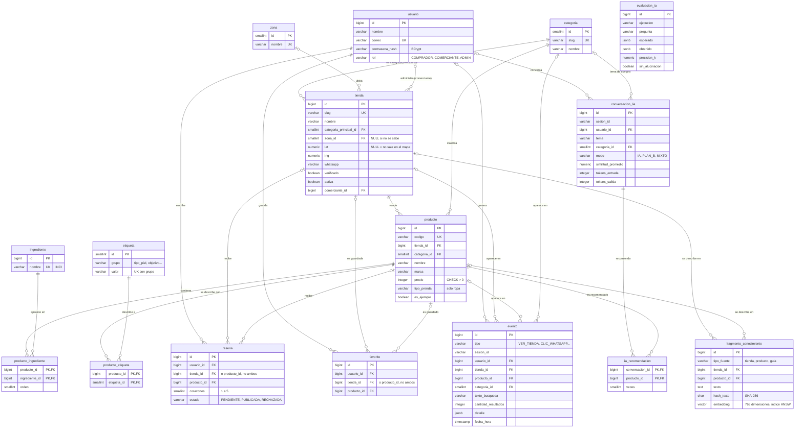

# Diagrama entidad-relación de StyleMe

> **Motor:** PostgreSQL 17 + pgvector · **16 tablas** en 4 grupos · **Normalizado hasta 4FN**.
> Versión completa con todos los campos y reglas: [`entidad-relacion.dbml`](entidad-relacion.dbml) (se ve en [dbdiagram.io](https://dbdiagram.io)).
> Justificación de cada campo: [modelo de datos](../planeacion/15-modelo-de-datos.md).

---

## 1. El diagrama

**Cómo leer las líneas:** `||` = exactamente uno · `|o` = cero o uno (opcional) · `o{` = cero o muchos.
Ejemplo: `tienda ||--o{ producto` → *una tienda vende cero o muchos productos; cada producto pertenece a exactamente una tienda.*

---

## 2. Explicación para la sustentación

### 2.1 La idea general (en 30 segundos)

> "StyleMe tiene **16 tablas organizadas en 4 grupos**. El **catálogo** guarda las tiendas y productos reales de Bucaramanga.
> La **comunidad** guarda usuarios, reseñas y favoritos. El grupo de **análisis** registra lo que pasa en la página para
> calcular indicadores. Y el grupo de **IA** guarda los textos con sus **embeddings** en una columna `vector(768)` de pgvector,
> con un **índice HNSW**, que es lo que permite la búsqueda semántica y el RAG de Lía.
> Todo el modelo está **normalizado hasta la cuarta forma normal**."

### 2.2 Los 4 grupos

| Grupo | Tablas | Pregunta que responde |
|---|---|---|
| **Catálogo** | `categoria`, `zona`, `tienda`, `producto`, `ingrediente`, `producto_ingrediente`, `etiqueta`, `producto_etiqueta` | ¿Qué se vende, dónde y con qué características? |
| **Comunidad** | `usuario`, `resena`, `favorito` | ¿Qué opinan y qué guardan las personas? |
| **Análisis** | `evento`, `conversacion_lia`, `lia_recomendacion` | ¿Qué hace la gente en la página y con Lía? |
| **IA (RAG)** | `fragmento_conocimiento`, `evaluacion_ia` | ¿Qué sabe Lía y qué tan bien responde? |

### 2.3 Puntos importantes que conviene mencionar

1. **Reseñas y favoritos polimórficos sin duplicar tablas.**
   Una reseña puede ser de una tienda **o** de un producto. En vez de dos tablas iguales, hay una sola con dos llaves
   foráneas opcionales y una regla `CHECK ((tienda_id IS NULL) <> (producto_id IS NULL))` que obliga a llenar
   **exactamente una**. Además, `UNIQUE (usuario_id, tienda_id)` y `UNIQUE (usuario_id, producto_id)` impiden reseñar dos
   veces lo mismo (en PostgreSQL los `NULL` no chocan en un `UNIQUE`, por eso funciona).

2. **La tabla `etiqueta` agrupa 6 listas distintas en 2 tablas.**
   Tipo de piel, tipo de cabello, cuero cabelludo, objetivos, "libre de" y paso de la rutina se guardan como pares
   `(grupo, valor)`. Así el recomendador busca *"productos para piel grasa en el paso sérum"* con una sola consulta,
   y agregar una característica nueva no obliga a crear tablas.

3. **El embedding vive en su propia tabla, no en `producto`.**
   `fragmento_conocimiento` guarda **trozos de texto** (de tiendas, productos y guías escritas por la autora) con su vector.
   Así Lía no solo sabe de productos, y un producto puede tener varios fragmentos si su texto es largo.
   - `hash_texto` (SHA-256) evita recalcular embeddings si el texto no cambió → **ahorra tokens**.
   - `modelo_embedding` permite saber qué recalcular si se cambia de modelo.
   - **Índice HNSW** con distancia coseno: encuentra los vectores más parecidos **sin compararlos todos**.

4. **Privacidad por diseño (Ley 1581).**
   `usuario` solo tiene los datos mínimos y la contraseña cifrada con BCrypt. De Lía **no se guarda lo que escribe la persona**:
   solo un resumen por conversación (tema, sentimiento, modo, tokens) en `conversacion_lia`.

5. **Datos honestos.**
   `tienda.verificado` y `producto.es_ejemplo` distinguen los datos reales de los de ejemplo. También sirven como indicador
   de calidad de los datos en el informe.

6. **Pensado para el análisis.**
   `evento` registra cada acción con su tipo, fecha y hora, dispositivo y, en las búsquedas, cuántos resultados hubo.
   El índice `(tipo, fecha_hora)` acelera las consultas del informe.

### 2.4 Formas normales, una por una

#### 1FN · Primera forma normal: valores atómicos, sin listas ni grupos repetidos
**Regla:** cada celda guarda **un solo valor** y no hay columnas repetidas (`ingrediente1`, `ingrediente2`…).

**En StyleMe:** en el sitio original, un producto guardaba listas dentro de un campo:
`ingredientes: ["Water", "Glycerin", ...]` y `tipoPiel: ["mixta", "grasa"]`. Eso **viola la 1FN**.
**Solución:** cada ingrediente es una fila en `ingrediente` y la relación se guarda en `producto_ingrediente`
(una fila por par producto–ingrediente). Igual con las etiquetas en `producto_etiqueta`.

> Pregunta típica: *"¿Y la columna `embedding`? Son 768 números."*
> **Respuesta:** el vector es **un solo valor atómico** del tipo `vector`, como una fecha o un punto en el mapa.
> No se consulta "el número 300 del vector"; siempre se usa completo para calcular distancias. Por eso no viola la 1FN.

#### 2FN · Segunda forma normal: todo depende de la llave **completa**
**Regla:** estar en 1FN y, en tablas con **llave compuesta**, que ningún atributo dependa solo de **una parte** de la llave.

**En StyleMe:** las tablas con llave compuesta son `producto_ingrediente`, `producto_etiqueta` y `lia_recomendacion`.
- En `producto_ingrediente (producto_id, ingrediente_id)`, el único atributo extra es `orden`, y depende de **los dos**:
  la Niacinamida puede ser el ingrediente 3 en un sérum y el 8 en una crema.
- El nombre del ingrediente **no** está ahí (dependería solo de `ingrediente_id`): está en `ingrediente`.
- En `lia_recomendacion (conversacion_id, producto_id)`, `veces` depende de **los dos**: cuántas veces se recomendó
  *ese* producto en *esa* conversación.

#### 3FN · Tercera forma normal: sin dependencias transitivas
**Regla:** estar en 2FN y que ningún atributo dependa de otro atributo que **no** sea la llave (A → B → C).

**En StyleMe:**
- `tienda` guarda `zona_id`, **no** el nombre de la zona. Si guardara "Cabecera" como texto, el nombre dependería de la
  zona y no de la tienda (tienda → zona → nombre). Con la tabla `zona`, cambiar un nombre es actualizar **una** fila.
- `producto` guarda `tienda_id`, **no** la dirección ni el WhatsApp de la tienda.
- `resena` guarda `usuario_id`, **no** el nombre del usuario.
- `categoria` evita repetir "skincare" en cada producto con riesgo de escribirlo distinto ("Skincare", "skin care").

#### 4FN · Cuarta forma normal: sin dependencias multivaluadas independientes en la misma tabla
**Regla:** estar en FNBC y que una tabla no mezcle **dos hechos de varios valores que son independientes entre sí**.

**En StyleMe:** un producto tiene **varios ingredientes** y, por separado, **varias etiquetas** (tipos de piel, objetivos…).
Son hechos **independientes**: que un sérum tenga Niacinamida no tiene nada que ver con que sea para piel grasa.
Si se guardaran en una sola tabla `producto_ingrediente_etiqueta (producto, ingrediente, etiqueta)`, habría que
**combinar todos con todos**: 7 ingredientes × 4 etiquetas = 28 filas para un solo producto, llenas de repeticiones,
y agregar una etiqueta obligaría a insertar 7 filas.
**Solución:** dos tablas separadas, `producto_ingrediente` y `producto_etiqueta` → **cumple la 4FN**.
Lo mismo pasa con reseñas y favoritos: son hechos independientes del usuario y viven en tablas distintas.

> Nota: la 4FN exige estar antes en **FNBC** (Boyce-Codd): todo determinante es llave candidata. En StyleMe, los únicos
> determinantes además de las llaves primarias son las columnas `UNIQUE` (`slug`, `codigo`, `correo`, `(grupo, valor)`),
> y todas son llaves candidatas.

### 2.5 Decisiones conscientes (excepciones justificadas)

En la sustentación es mejor decirlas antes de que las pregunten:

| Campo | Por qué se ve "no normalizado" | Por qué está bien |
|---|---|---|
| `evento.detalle` (`jsonb`) | Guarda datos variables | Cada tipo de evento trae datos distintos (el tipo de piel elegido, las tiendas de una salida). Son datos **de registro**, que no se actualizan ni se relacionan: crear 10 tablas para eso sería sobre-diseño |
| `evaluacion_ia.esperado` / `obtenido` (`jsonb`) | Guardan estructuras | Son la **evidencia** de cada prueba de IA, tal cual se ejecutó. Se leen completas, no se consultan por partes |
| `conversacion_lia.cantidad_mensajes`, `similitud_promedio` | Parecen datos calculados | Se calculan de mensajes que **no se guardan** (por privacidad). No hay de dónde recalcularlos, así que no son redundantes |
| `tienda.horario` (texto) | Podría ser una tabla por día | Hoy solo se muestra, no se consulta "qué tiendas abren el domingo". Si se necesita, se separa después |

### 2.6 Preguntas que pueden hacer (y respuestas cortas)

| Pregunta | Respuesta |
|---|---|
| ¿Por qué PostgreSQL y no MySQL? | Por **pgvector**: guarda embeddings, los indexa con HNSW y busca por similitud dentro de la misma base. Además tiene `jsonb` y buenas funciones de análisis |
| ¿Qué es un embedding? | Una lista de 768 números que representa el **significado** de un texto. Textos con significado parecido tienen vectores cercanos |
| ¿Qué hace el índice HNSW? | Organiza los vectores como un grafo de "vecinos" para encontrar los más parecidos **sin compararlos todos**, en milisegundos |
| ¿Por qué `slug` además de `id`? | El `id` numérico es para las relaciones (más rápido). El `slug` (`bohor`) es para los enlaces legibles de la página |
| ¿Por qué `es_ejemplo` en vez de borrar los productos de ejemplo? | Para ser transparentes: el informe puede separar datos reales de los de ejemplo |
| ¿Cómo evitan que Lía invente productos? | La IA solo recibe como contexto los fragmentos recuperados de la base, y el backend **valida** que cada producto recomendado exista en `producto` |
